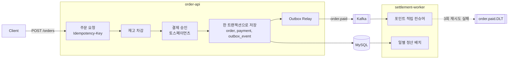
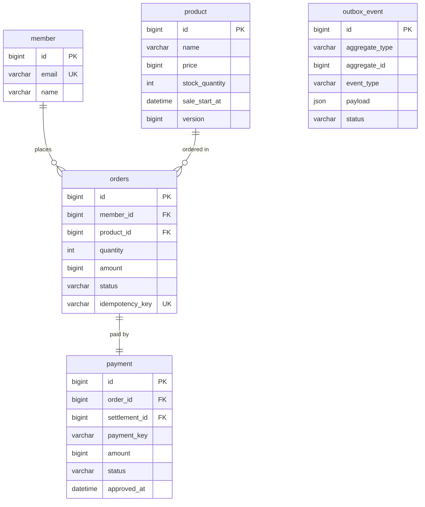

# flashpay

한정 수량 상품을 선착순으로 판매하고, 결제 완료 이벤트를 Kafka로 넘겨 포인트 적립과 일별 정산까지 처리하는 백엔드 프로젝트입니다.

트래픽이 몰려도 **재고, 결제, 정산 금액이 한 건도 어긋나지 않는다**는 것을 테스트와 부하 측정 숫자로 보여주는 것이 목표입니다.

## 핵심 과제

| 과제 | 접근 방법 | 상태 |
| --- | --- | --- |
| 중복 주문 방지 | `Idempotency-Key` 헤더와 DB 유니크 제약 | 예정 |
| 선착순 재고 정합성 | DB 비관적 락으로 시작해 Redis 원자 차감으로 개선, k6로 비교 | 예정 |
| 결제 연동 | 토스페이먼츠 테스트 키, 실패 시 재고 복구 | 예정 |
| 이벤트 유실 방지 | Transactional Outbox 패턴으로 DB 커밋 후에만 Kafka 발행 | 예정 |
| 중복 소비 방지 | `processed_event` 테이블로 컨슈머 멱등 처리, 실패 메시지는 DLT | 예정 |
| 정산 정확성 | Spring Batch 일별 정산과 PG 거래 대사 | 예정 |

## 아키텍처



- 주문 상태 변경과 `outbox_event` 저장을 한 트랜잭션으로 묶어, 결제는 됐는데 이벤트가 사라지는 상황을 막습니다.
- Outbox Relay는 at-least-once로 발행하므로 컨슈머 쪽에서 `processed_event`로 중복을 걸러냅니다.
- 정산 배치는 Kafka를 거치지 않고 DB의 결제 내역을 직접 집계합니다.

## ERD (order-api)



`point_history`, `processed_event`, `settlement`은 settlement-worker 모듈과 함께 추가할 예정입니다.

## 기술 스택

| 영역 | 사용 기술 |
| --- | --- |
| Language | Java 25 (Virtual Thread) |
| Framework | Spring Boot 4.1, Spring Data JPA |
| Database | MySQL 8.4, Redis 7.4 |
| Messaging | Apache Kafka 4.1 (KRaft) |
| Build | Gradle 멀티모듈 |
| 예정 | Spring Batch, Testcontainers, k6, OpenTelemetry, Prometheus, Grafana, k3s, GitHub Actions |

## 모듈 구조

```
flashpay
├── common              두 앱이 함께 쓰는 이벤트 DTO
├── order-api           주문, 재고, 결제, Outbox 발행
└── settlement-worker   포인트 적립 컨슈머, 정산 배치 (예정)
```

`order-api` 패키지는 기능별로 나눕니다.

```
com.flashpay.orderapi
├── global     config, entity, exception, init
├── member
├── product    controller, service, dto, domain, repository
├── order
├── payment
└── outbox
```

## 실행 방법

```bash
# 1. MySQL(23306), Redis(6379), Kafka(9092) 실행
docker compose up -d

# 2. order-api 실행
./gradlew :order-api:bootRun

# 3. 상태 확인
curl localhost:8080/actuator/health
```

로컬 실행 시 샘플 데이터(회원 1명, 상품 3개)가 자동으로 들어갑니다. `flashpay.sample-data.enabled=false`로 끌 수 있습니다.

## API

| Method | URL | 설명 |
| --- | --- | --- |
| GET | `/products?page=0&size=20` | 상품 목록 조회 |
| GET | `/products/{productId}` | 상품 상세 조회 |

상품 응답의 `saleStatus`는 현재 시각과 재고를 기준으로 `UPCOMING`, `ON_SALE`, `SOLD_OUT` 중 하나입니다.

에러 응답은 RFC 9457 `ProblemDetail` 형식을 따릅니다.

```json
{
  "type": "about:blank",
  "title": "PRODUCT_NOT_FOUND",
  "status": 404,
  "detail": "상품을 찾을 수 없습니다.",
  "code": "PRODUCT_NOT_FOUND"
}
```

## 진행 현황

- [x] 1주차: 멀티모듈 구성, Docker Compose, 엔티티, 상품 조회 API
- [ ] 2주차: 주문 생성, 멱등성, 재고 동시성 (비관적 락, Redis 비교)
- [ ] 3주차: 토스페이먼츠 결제 연동
- [ ] 4주차: Kafka, Outbox, 포인트 적립 컨슈머
- [ ] 5주차: 정산 배치, Testcontainers 통합 테스트
- [ ] 6주차: Virtual Thread 성능 비교, 모니터링
- [ ] 7주차: k3s, AWS 배포, CI
- [ ] 8주차: Spring Boot 4.2 업그레이드, MCP 서버
